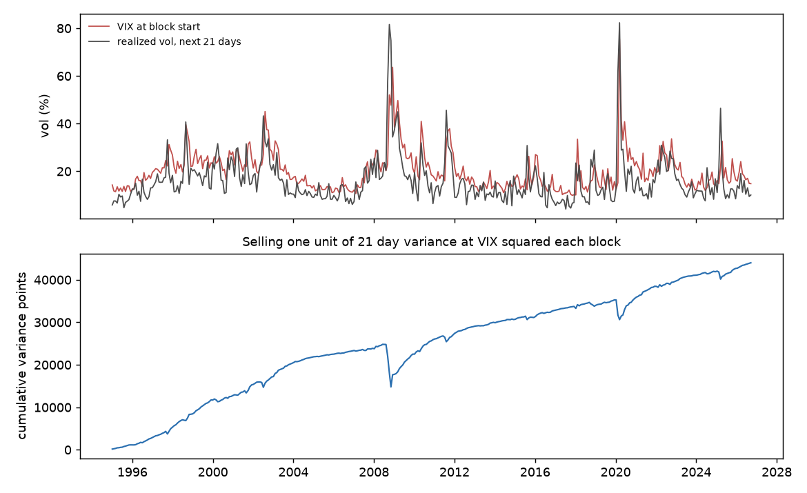
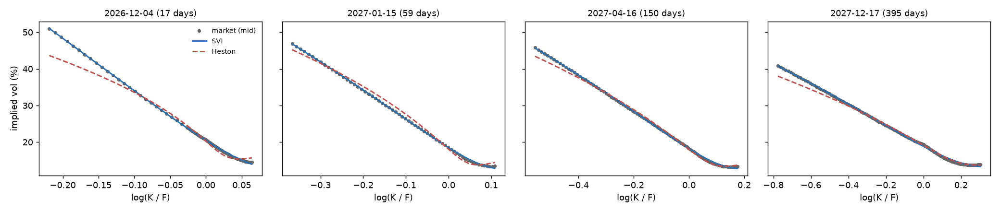

# SPY volatility surface and the VIX premium

[](https://github.com/rxj0102/options-vol-surface/actions/workflows/ci.yml)

Two questions about option implied volatility, answered on free data.

1. **Does VIX overstate the volatility that follows, and does it still forecast it?** 36 years of daily VIX and S&P 500 closes, with a GARCH model refit every year on past data only as the competing forecast.
2. **What does one day's SPY surface look like, what can Heston not fit, and what does it imply for the price at expiry?** A committed snapshot of the SPY option chain, turned into implied vols without assuming a rate or dividend, fitted by one Heston model and by SVI expiry by expiry, then turned into risk-neutral densities.

Every number below is written into this file by `scripts/render_readme.py` from `results/metrics.json`, which `scripts/reproduce.py` builds from the files in `data/`. CI reruns the study and fails if the numbers or this README change.

## 1. VIX against the volatility that followed

<!-- vrp:start (generated by scripts/render_readme.py, do not edit by hand) -->
381 non-overlapping 21 trading day blocks, 1995 to 2026. Forecasts are fixed at the close of the first day; realized variance uses the next 21 daily returns.

**The premium.** VIX averaged 20.0 and the volatility that followed averaged 16.0. VIX was above the realized volatility of its block in 84% of blocks, by 4.1 vol points on average (median 4.7, Newey-West t 10.2).

**Selling it.** Selling one unit of 21 day variance at VIX squared each block earned 115 variance points (vol points squared) a block (t 4.1), a Sharpe ratio of 0.85 a year with skewness -4.2. The three worst blocks (2008-10, 2020-02, 2008-11) together lost an amount equal to 25% of the strategy's net profit over the whole sample. The 2020-02 block started with VIX at 15.2; realized volatility over the next month was 61.5.

**Forecasting.** Realized variance compared with each forecast:

| Forecast | Mean forecast vol | MSE (x 1e-4) | QLIKE | Mincer-Zarnowitz slope | R2 |
|---|---|---|---|---|---|
| VIX squared | 20.0 | 23.48 | 0.327 | 0.95 (se 0.14) | 0.50 |
| GARCH(1,1), refit yearly | 16.5 | 22.86 | 0.300 | 0.94 (se 0.15) | 0.48 |
| Trailing 21 day realized | 16.0 | 33.61 | 0.454 | 0.62 (se 0.13) | 0.38 |

GARCH has the lower MSE and QLIKE, but neither difference is significant (Diebold-Mariano p 0.80 and 0.19). Both beat the trailing realized variance on QLIKE (p 0.013 for VIX, 0.0001 for GARCH). So VIX is too high on average but not a worse forecast than a GARCH model: the bias is a level shift. In logs, regressing realized on both forecasts gives VIX a weight of 0.79 (t 7.5) and GARCH 0.25 (t 2.5); in levels, 0.57 (t 2.5) and 0.43 (t 1.6). Option prices carry information about future volatility that past returns do not.
<!-- vrp:end -->



**Method.** Blocks of 21 trading days do not overlap, so each observation is independent of the next one's realized window and the t-statistics are not inflated by overlap (Newey-West with 3 lags is used anyway). VIX is a 30 calendar day variance swap rate on SPX options, about 21 trading days. The GARCH(1,1) model is fitted by Gaussian quasi likelihood with variance targeting at the start of each year on all earlier returns (first fit 1990 to 1994), and its 21 day forecast is the analytic average of the expected variance path. QLIKE is the loss that is robust to noise in realized variance (Patton 2011); MSE is dominated by a handful of crash months.

## 2. One day's surface

<!-- surface:start (generated by scripts/render_readme.py, do not edit by hand) -->
Snapshot `spy_chain_2026-11-17.csv.gz`, pulled 2026-11-17 16:14 UTC with SPY at 732.88. 2353 out-of-the-money quotes across 18 expiries survive the filters (both sides quoted, spread under half the mid, mid at least 5 cents, between the 2 delta put and call), out of 7120 raw quotes.

| Expiry | Days | Quotes | ATM vol | 25d risk reversal | 25d butterfly | SVI RMSE | Heston RMSE |
|---|---|---|---|---|---|---|---|
| 2026-12-04 | 17 | 94 | 20.6 | -8.0 | 0.61 | 0.16 | 1.81 |
| 2026-12-11 | 24 | 99 | 20.2 | -8.1 | 0.63 | 0.17 | 1.43 |
| 2026-12-18 | 31 | 129 | 19.9 | -8.2 | 0.56 | 0.21 | 1.04 |
| 2026-12-24 | 37 | 98 | 19.3 | -8.1 | 0.59 | 0.19 | 0.88 |
| 2026-12-31 | 44 | 235 | 18.8 | -8.0 | 0.60 | 0.19 | 1.01 |
| 2027-01-15 | 59 | 63 | 18.6 | -7.8 | 0.60 | 0.16 | 0.90 |
| 2027-01-29 | 73 | 205 | 18.4 | -7.8 | 0.56 | 0.17 | 0.70 |
| 2027-02-19 | 94 | 77 | 18.3 | -7.8 | 0.52 | 0.18 | 0.72 |
| 2027-02-26 | 101 | 140 | 18.3 | -7.8 | 0.48 | 0.10 | 0.52 |
| 2027-03-19 | 122 | 86 | 18.3 | -7.9 | 0.50 | 0.20 | 0.67 |
| 2027-03-31 | 134 | 170 | 18.2 | -7.9 | 0.50 | 0.16 | 0.61 |
| 2027-04-16 | 150 | 93 | 18.3 | -7.9 | 0.44 | 0.20 | 0.71 |
| 2027-04-30 | 164 | 143 | 18.5 | -7.9 | 0.35 | 0.10 | 0.30 |
| 2027-06-17 | 212 | 107 | 18.7 | -7.8 | 0.15 | 0.23 | 0.81 |
| 2027-06-30 | 225 | 171 | 18.6 | -7.7 | 0.11 | 0.14 | 0.24 |
| 2027-09-17 | 304 | 123 | 19.1 | -7.5 | -0.17 | 0.23 | 0.80 |
| 2027-09-30 | 317 | 183 | 19.0 | -7.5 | -0.15 | 0.13 | 0.17 |
| 2027-12-17 | 395 | 137 | 19.3 | -7.2 | -0.31 | 0.23 | 0.84 |

Vols and RMSEs in vol points. Risk reversal is the 25 delta call vol minus the 25 delta put vol.

One Heston parameter set for the whole surface: v0 0.0569, kappa 8.23, theta 0.0519, sigma_v 2.34, rho -0.75. Feller ratio 2 kappa theta / sigma_v^2 = 0.16 (below 1, so the variance process can reach zero, which is typical of fits to index smiles). Overall RMSE 0.83 vol points against 0.18 for SVI fitted expiry by expiry; 1.22 on expiries under 55 days and 0.62 beyond. One set of five parameters has to produce every maturity's smile at once, and its errors are largest in the shortest expiries, where the smile is steepest in strike. SVI, with five parameters for each expiry, fits every slice to within a fraction of a vol point.

SVI static arbitrage checks: 0 of 18 slices have butterfly arbitrage on their quoted range (minimum g(k) 0.145); 0 calendar violations on the log-moneyness range all expiries share (-0.22 to 0.06).
<!-- surface:end -->



**Method.**
- The chain is every SPY option quote at 11:14 New York time on 2026-11-17, from Cboe's free delayed quote feed, with SPY down about 1% on the day. The feed's underlying price at the same moment is the spot. Yahoo was tried first: outside market hours it returns zero bids and asks for every option. An earlier version of this section used the 2026-11-16 closing quotes; `scripts/fetch_data.py --chain` takes whichever the feed serves when it runs.
- Mid quotes only, kept when both sides are quoted, the spread is under half the mid and the mid is at least 5 cents; then only quotes between the 2 delta put and the 2 delta call. Last trade prices are not used: they are stale and taken at different spot levels.
- Discount factors come from the Treasury curve on the latest date with data (FRED constant maturity yields, interpolated in maturity). The forward per expiry is F = K + (C minus P) / D at the five strikes where call and put are closest in price, median taken, as in the Cboe VIX calculation. A regression of C minus P on the strike, which would also estimate D, was tried first and gave negative interest rates for every expiry: SPY options are American, and the early exercise premium of in-the-money puts grows with the strike and bends the regression. Near the money that premium is small.
- Black-76 implied vols of out-of-the-money quotes: puts below the forward, calls above.
- Heston is fitted to all expiries at once by least squares on price errors divided by vega, which approximates vol errors, from four starting points. The pricer integrates the characteristic function (little trap form) on a fixed Gauss-Legendre grid, checked against adaptive quadrature in the tests.
- SVI (Gatheral 2004) is fitted to total variance per expiry, with the wing slopes capped at 1.99, just inside Roger Lee's bound of 2, so the implied density has a mean. For each (m, sigma) the other three parameters are an exact bounded linear least squares problem (the quasi-explicit method), and (m, sigma) are searched on a grid and then refined, so the fit does not depend on a starting point. Butterfly arbitrage is checked with Gatheral and Jacquier's g(k) on each slice's quoted range; calendar arbitrage by requiring total variance to rise with maturity at fixed log-moneyness.

## 3. What the surface says about the price at expiry

<!-- density:start (generated by scripts/render_readme.py, do not edit by hand) -->
Each SVI slice implies a density for the price at expiry (the second strike derivative of call prices). Every density integrates to 1 within 7.0e-04, and every slice respects Roger Lee's moment bound (steepest wing slope 1.99 against a limit of 2), so each has a finite mean. As a model-free check, the price of a tight put spread around 90% of the forward is the market's own P(S_T below that strike); across 18 expiries it differs from the SVI density's value by at most 0.5 percentage points. The columns compare the probability of a fall below 90% or 80% of the forward with a lognormal at the same expiry's at-the-money total variance, which is what a flat smile would say.

| Expiry | Days | P(below 90% of F) | Lognormal at ATM vol | P(below 80% of F) | Lognormal at ATM vol | Mass inside quoted strikes |
|---|---|---|---|---|---|---|
| 2026-12-04 | 17 | 3.8% | 0.9% | 0.75% | 0.00% | 97.0% |
| 2026-12-11 | 24 | 5.2% | 2.2% | 1.20% | 0.00% | 97.0% |
| 2026-12-18 | 31 | 6.4% | 3.6% | 1.63% | 0.01% | 97.1% |
| 2026-12-24 | 37 | 7.1% | 4.5% | 1.86% | 0.01% | 96.8% |
| 2026-12-31 | 44 | 7.8% | 5.7% | 2.17% | 0.04% | 97.2% |
| 2027-01-15 | 59 | 9.3% | 8.4% | 2.86% | 0.15% | 96.9% |
| 2027-01-29 | 73 | 10.5% | 10.6% | 3.54% | 0.36% | 97.4% |
| 2027-02-19 | 94 | 12.2% | 13.7% | 4.38% | 0.89% | 97.2% |
| 2027-02-26 | 101 | 12.8% | 14.6% | 5.02% | 1.11% | 95.4% |
| 2027-03-19 | 122 | 14.2% | 17.2% | 5.59% | 1.95% | 97.1% |
| 2027-03-31 | 134 | 14.9% | 18.3% | 6.03% | 2.42% | 96.9% |
| 2027-04-16 | 150 | 15.8% | 19.9% | 6.64% | 3.20% | 97.0% |
| 2027-04-30 | 164 | 16.7% | 21.3% | 7.69% | 3.95% | 94.4% |
| 2027-06-17 | 212 | 18.9% | 24.8% | 8.84% | 6.39% | 97.0% |
| 2027-06-30 | 225 | 19.5% | 25.6% | 9.68% | 7.06% | 93.8% |
| 2027-09-17 | 304 | 22.4% | 29.7% | 11.76% | 11.01% | 96.7% |
| 2027-09-30 | 317 | 23.0% | 30.3% | 12.87% | 11.73% | 91.2% |
| 2027-12-17 | 395 | 25.0% | 33.0% | 14.19% | 14.88% | 96.4% |

The last column is the share of each density that sits between the lowest and highest quoted strikes; the rest comes from SVI's straight-line wings, so tail probabilities beyond the quotes are extrapolation.
<!-- density:end -->

The snapshot is one moment. A new pull with `python scripts/fetch_data.py --chain` gives different numbers; the free feeds serve only the current chain, so past snapshots cannot be rebuilt.

## Layout

| Path | What it does |
|---|---|
| `integration/vrp.py` | VIX study: blocks, GARCH, losses, Diebold-Mariano, Mincer-Zarnowitz |
| `surface/chain.py` | Snapshot loading, mids, parity forwards, Black-76 vols, smile statistics |
| `surface/fit.py` | Vectorized Heston pricer and fit, SVI fit, arbitrage checks and implied densities |
| `pricing/` | Black-Scholes with Greeks and implied vol; Heston by quadrature |
| `hedging/delta_hedge.py` | Delta hedging simulation on GBM paths with P&L attribution (a teaching module; its tests check the attribution closes and hedge error falls with rebalancing) |
| `scripts/fetch_data.py` | Pulls the chain snapshot and the VIX and S&P 500 history |
| `scripts/reproduce.py` | Runs both studies, writes `results/` |

## Tests

`pytest -q` checks, among other things, that the Heston fit recovers known parameters from a synthetic chain, that parity recovers a known forward and discount factor, that SVI recovers a known slice and flags Vogt's arbitrage example, that GARCH forecasts do not change when later returns do, and that realized variance starts the day after the forecast.

## Corrections

A first version of this rebuild estimated forwards by regressing C minus P on the strike; it implied negative rates (see the method above) and was replaced before any result was published.

An earlier version of this repo compared GARCH forecasts with an implied volatility that was simulated as the GARCH forecast plus 2 points, then reported that implied vol trades about 2 points above GARCH. That comparison was circular and has been replaced by the VIX study above. It also fell back to synthetic option quotes when the download failed, calibrated to calls only with a fixed 5% rate and no dividend, and reported results from a live chain that could not be reproduced. The chain is now a committed snapshot and the surface uses parity forwards and out-of-the-money quotes from both sides.

## Reproducibility

### Data availability

All inputs are free and committed in `data/`: daily closes of VIX (`^VIX`) and the S&P 500 (`^GSPC`) from Yahoo Finance, one SPY option chain snapshot from Cboe's delayed quote feed, and the Treasury curve for that day from FRED. No key is needed.

### Computational requirements

- Python 3.12.3. Every dependency version is pinned in `uv.lock`.
- Checked on Linux x86_64 with 2 CPU cores and 8 GB RAM. No GPU is needed.

```bash
pip install uv                     # once
uv sync                            # installs the exact pinned environment
uv run python scripts/reproduce.py # rebuilds results/ from data/
uv run pytest -q                   # runs the test suite
```

### Runtime

`scripts/reproduce.py` takes under a minute; the test suite under a minute.

### Citation

Citation metadata is in `CITATION.cff`. GitHub turns it into a Cite this repository button on the repo page.

## References

- Gatheral, J. (2004). A parsimonious arbitrage-free implied volatility parameterization. Global Derivatives.
- Gatheral, J. and Jacquier, A. (2014). Arbitrage-free SVI volatility surfaces. Quantitative Finance 14(1).
- Albrecher, H., Mayer, P., Schoutens, W. and Tistaert, J. (2007). The little Heston trap. Wilmott Magazine.
- Patton, A. (2011). Volatility forecast comparison using imperfect volatility proxies. Journal of Econometrics 160(1).
- Carr, P. and Wu, L. (2009). Variance risk premiums. Review of Financial Studies 22(3).
